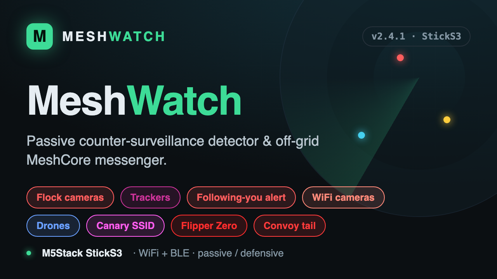

# MeshWatch

Passive surveillance-hardware detector (M5Stack StickS3) that also works as a
standalone MeshCore messenger through a companion radio, plus an optional web
app that does the same from a phone or laptop.

```
StickS3 detector --BLE--> MeshCore radio --LoRa--> mesh        (standalone)
StickS3 detector --BLE--> web app --BLE/USB--> MeshCore radio  (with the app)
```

## Install

**Hardware:** M5Stack StickS3 (ESP32-S3). A MeshCore companion radio (any
MeshCore node over BLE) is optional, for the messaging and alert-forwarding
features.

### Flash with M5Burner (easiest)



1. Open **M5Burner**, search for **MeshWatch** (or use *Add firmware* with
   `dist/meshwatch-m5sticks3-*.bin`).
2. Select your StickS3's serial port and **Burn**. The image is a full 8 MB
   flash (bootloader + partitions + app at offset `0x0`).

### Flash from source (PlatformIO)

```sh
cd firmware
pio run -t upload
```

### Flash the prebuilt binary manually

```sh
esptool.py --chip esp32s3 write_flash 0x0 dist/meshwatch-m5sticks3-v2.4.1-8MB.bin
```


## Detector firmware (`firmware/`)

| Category | How it is detected |
|---|---|
| Flock ALPR camera | WiFi probe-request fingerprint, Flock OUIs, `Flock-xxxxxx` SSID, Flock GATT service |
| Flock battery pack | BLE name `Penguin-…` / `FS Ext Battery`, manufacturer ID 0x09C8 |
| Raven gunshot sensor | BLE service UUIDs 0x3100-0x3500 |
| Axon body cam / Taser | OUI 00:25:DF on BLE or WiFi, `Axon…` name or SSID |
| Trackers | Find My (separated), Tile, SmartTag, Chipolo, Google Find My Device, and named trackers (Pebblebee, Nutale, Atuvos, Cube, iTag...) |
| Smart glasses | Meta company IDs / service UUID (also matches other Meta wearables) |
| WiFi deauth flood | 20+ deauth/disassoc frames in 5 s |
| Beacons | iBeacon, Eddystone (listed quietly) |
| MeshCore radios | BLE name `MeshCore-…` (listed quietly) |
| Rogue AP (karma) | one transmitter beaconing 6+ different SSIDs in 30 s (Pineapple-style) |
| Attack tools | BLE advert spam flood; **WiFi beacon-spam flood** (40+ random-MAC fake APs in 3 s, e.g. Marauder / Ghost ESP); **WPA handshake / PMKID capture** (unencrypted EAPOL key frames, flagged strongest when they follow a deauth); Flipper Zero by service UUID 0x308x, HID-from-ST-OUI (BadKB), attack-app names |
| Card skimmers | BLE serial-module names HC-03/05/06/08, JDY-, AT-09, BT05, SPP-CA (also common in hobby kits) |
| WiFi / spy cameras | surveillance-camera vendor OUIs (Hikvision, Dahua, Reolink, Wyze, Ezviz, Arlo, Ring, Axis) and SSID/name substrings for CCTV, action cams (GoPro, Osmo) and cheap hidden-cam firmware (V380, iCSee, P2P, CloudEdge, Yoosee, CamHi, A9...) |
| Drones | Open Drone ID / Remote ID over WiFi (NAN frames, beacon vendor IE) and BLE (service data 0xFFFA); **plus WiFi SSID / BLE name** for drones in WiFi mode (DJI/Mavic/Phantom/Tello, Autel/EVO, Parrot/Anafi, Skydio...) |
| Pwnagotchi | WiFi beacon whose SSID is a JSON blob containing "pwnd_tot" (listed under Attack tools) |
| Meshtastic radios | BLE 128-bit service UUID 6ba1b218-... (listed under MeshCore/mesh radios) |
| Canary SSID | a bait network name you arm: an AP beaconing it (evil twin) or a client probing for it raises a Canary alert |

Confidence runs 0-4. Confidence 3+ sounds the speaker and raises a banner.
Several Flock OUIs are shared with consumer hardware, so a bare OUI match is
confidence 2 or lower. A tracker in range across 10 separate minutes is flagged
as persistent.

**"Following you" detection**: any device that stays with you is promoted to a
dedicated red **FOLLOWING YOU** banner with its own urgent tone, not just a
quiet listing. There are two paths:

- *GPS path* (strongest, needs a radio that reports position): a non-fixed
  device that stays in range while you actually travel ~120 m or more is flagged
  whatever its type. The banner shows how far it shadowed you.
- *Time path* (no GPS needed): wearable surveillance — trackers (10 min), body
  cams and smart glasses (4 min) — seen across that many separate minute-windows
  is flagged as following. Fixed infrastructure (Flock, WiFi cameras, Raven) is
  never called "following" on time alone, so walking past them does not alarm.

**Convoy / hand-off detection**: a real surveillance team rotates units so no
single device lingers long enough to trip "following". MeshWatch also watches the
*set* of mobile units around you — trackers, body cams, smart glasses, attack
tools, drones — and raises a red **CONVOY** banner (with its own urgent tone, and
a mesh alert to your team if forwarding is on) when three or more of them have
each recurred across 2+ minute-windows and are still in range. It names the count
and points you to the Radar. Catches a coordinated tail that per-device logic
misses.

**MAC-rotation grouping**: modern BLE devices randomise their address every few
minutes, which would otherwise reset the "following" counters and inflate device
counts. A named unit that rotates its MAC is recognised as the same device (by a
fingerprint of its advertised name) once its old address goes quiet, so
persistence and the radar stay accurate; such a device is marked as having
rotated. Deliberately anonymous trackers (Apple Find My) rotate their whole
payload by design and remain ungroupable.

Each threat class also has its **own alert tone**, so you can tell a camera from a
tracker from a Flipper from an evil-twin canary by ear, without looking.

### Messaging from the stick (no phone)

The stick connects to a MeshCore companion radio over Bluetooth, taking the
place of the phone app. The radio can only hold one Bluetooth connection, so
disconnect the phone first.

1. Hold B until SETTINGS, select Radio, press A and choose your radio.
2. Set Radio PIN to the PIN the radio shows (default 123456 on radios without a screen).
3. Hold B until MESSAGES. A opens a channel or contact, A again writes.

Buttons: A selects, B moves to the next item, hold B goes to the next screen or
back. While typing, A picks the character, hold A deletes, hold B scrolls fast.
Preset messages are in Dutch; edit `CANNED` in `firmware/src/main.cpp`.

"Forward alerts to mesh" in SETTINGS sends detections of confidence 3+ to the
chosen channel, at most once per device per 10 minutes. It is off by default.

On the DETECT screen, A mutes and B opens the MENU: "MeshCore messages" at the
top opens the messenger, followed by a scrolling checklist of the detection
categories starting with "Scan all". Unticked categories are
not scanned for, and the choice is remembered across restarts.

Blue-team features:

- **Stealth** (SETTINGS): stops the stick's own BLE advertising, switches BLE
  scanning to passive (no scan requests) and mutes, so the stick emits no
  detectable beacon. WiFi stays receive-only. A few name-based BLE detections
  weaken in this mode.
- **Baseline watch** (MENU): learn the devices in a trusted place for 60 s, then
  get alerted on anything new to the area, whatever its type. Good for sweeping
  a room or car.
- **Canary SSID**: arm a bait network name (from the app's Settings, or over USB
  with `canary <ssid>`). The detector then watches every beacon, probe response
  and probe request for that exact name. An AP advertising it is an **evil twin**
  impersonating your network (confidence 4); a client asking for it is a device
  that has the bait saved (confidence 3). Set it to a network you control and
  sweep for impostors in the field, or to a unique name that should exist
  nowhere as a pure honeytoken. Toggle it on/off in SETTINGS. Note: near the real
  network of the same name it will match that AP, so it is a field tool.
- **Team alerts**: an incoming mesh message starting with `[MW]` (what this
  firmware and the app send when forwarding) is shown as a red TEAM ALERT banner
  with the threat tone, not a quiet chat line.
- **Geotagging**: when the radio reports a GPS/advert position (e.g. a Wio
  Tracker), every detection is stamped with latitude and longitude, and forwarded
  alerts carry coordinates. This also drives the GPS path of "Following you"
  detection.
- **Auto-report to mesh** (SETTINGS): every 5 minutes, sends a one-line summary
  of what is in range (counts per threat category, plus position) to the forward
  channel, so a team or base station keeps a picture hands-free.
- **Signal finder direction cue**: while tracking a device, the screen shows a
  smoothed signal, a CLOSER / FARTHER triangle and a sparkline of recent signal,
  and ticks faster as you approach.
- **Device lock** (SETTINGS): an optional 6-digit unlock code asked at boot. A
  separate **duress wipe code** unlocks too but first erases the saved radio
  pairing and baseline. USB `lockoff` clears the lock so you can never be locked
  out permanently.

Not possible on this hardware, so not attempted: 5 GHz WiFi, classic Bluetooth,
cellular/IMSI-catcher detection, and offline (non-transmitting) cameras. IR
jamming was requested and declined: it is a transmit-side denial-of-service
technique, illegal to operate in the EU and US regardless of target, and the
StickS3 has no IR emitter.

Other features:

- **Signal finder** (MENU): pick a detected device and walk around; the screen
  shows its signal strength with a peak marker and the speaker ticks faster as
  you get closer. WiFi devices are followed on their own channel.
- **Clock** in the header, taken from the radio (Belgian time zone, set in `setup()`).
- **Screen off after** (SETTINGS): never / 15 / 60 / 300 s. Scanning continues;
  any button, alert or incoming message wakes it. The first press only wakes.
- **Announce me on the mesh** (SETTINGS): sends a flood advert from the radio.

- **Radar** (MENU): a live sweep showing every in-range detection placed by
  signal strength (distance from centre) and a stable per-device angle, coloured
  by category; names the closest one.
- **Sweep summary** (MENU): a one-screen verdict for the current sweep — how long
  you have scanned, how many devices and threats were seen, the worst one, a
  per-category tally, and whether anything is following you or arrived as a
  convoy. Says **AREA CLEAN** when nothing threatening is around. Hold A to start
  a fresh sweep.
- **Silence a device**: in the Signal finder, hold A to permanently ignore a
  device (e.g. your own gear). Ignored devices never alert and are listed muted;
  clear the list from Settings.
- **Close-range alarm** (SETTINGS): when a threat comes within about -52 dBm,
  the alert switches to an urgent repeating tone.
- **Boot splash**: a branded animated start-up screen (logo, wordmark, version);
  tap a button to skip it.
- **Battery icon**: the header shows a colour-coded battery (green / amber / red,
  with a charge tick on USB power) instead of a bare percentage.
- **Smooth motion**: the list highlight slides toward the selected row, the radar
  sweep has a fading trail and its blips glide to new distances, a small green
  "scanning" dot breathes in the header, and the screen fades in on wake. The UI
  runs at ~30 fps while animating and idles slowly to save power.

Debugging over USB serial: `firmware/shot.py` presses buttons and saves
screenshots; the firmware also prints pairing diagnostics as JSON lines.

Build and flash:

```sh
cd firmware
../.venv/bin/pio run -t upload
```

Restore the firmware that was on the stick before:

```sh
.venv/bin/python -m esptool --port /dev/cu.usbmodem1201 write_flash 0 backup/sticks3-original-8MB.bin
```

Signatures live in `firmware/src/signatures.h`. The Flock set comes from the
[flock-you](https://github.com/colonelpanichacks/flock-you) project. The Flipper
and card-skimmer signatures are adapted from the
[nyanBOX](https://github.com/jbohack/nyanBOX) project.

## App (`app/`)

Static files, no build step. Web Bluetooth needs Chrome or Edge (Android or
desktop) or Bluefy on iOS, and a secure origin: `localhost` works, a phone
needs the folder served over HTTPS.

```sh
cd app && python3 -m http.server 8377 --bind 127.0.0.1
# open http://127.0.0.1:8377
```

- **Radio** pairs a MeshCore companion radio over BLE (shift-click for USB serial).
- **Detector** pairs the StickS3.
- **Settings** turns on alert forwarding to a channel or contact, with a
  per-device cooldown, and optional location tagging.

`app/vendor/meshcore` is [meshcore.js](https://github.com/meshcore-dev/meshcore.js) (MIT).
